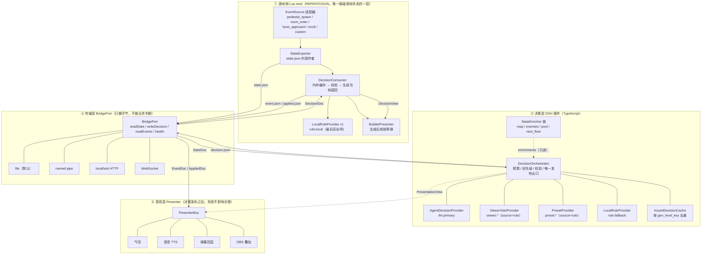
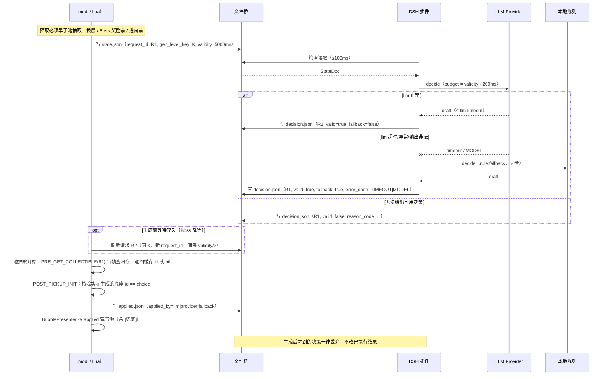

# 架构：分层、接口与扩展点（v1.1-draft.2）

> 版本：v1.1-draft.2（2026-11-07，t25 spike 修正 M7 表述：B 单独不可行，C 可行但 v1.1+）。协议细节见 [protocol.md](protocol.md) §12 变更记录。
> 配套：[协议](protocol.md)、[代码规范](standards.md)、[M5/M7 决策](reviews/decisions-m5-m7.md)。
> 目标：把“游戏侧读局面 / 插件侧做决策 / 表现层展示”拆成四层，层与层之间只通过本文列出的接口通信。**v1 的扩展点是概念约束，不是代码接口；改行为需改实现（见 M5 决策）。**

---

## 0. 三条硬约束（先看这个）

1. **生成当帧不能等。** REPENTOGON 的 `MC_PRE_GET_COLLECTIBLE`（回调 62）在**道具池抽取完成、底座实体生成之前**触发，必须 **当帧返回** 道具 id；返回 `nil` 走原版。因此：
   - 协议里的 1500ms 是 **决策有效期/超时判定**，不是 mod 的阻塞等待；
   - mod 必须在生成前 **预取** 决策到内存；回调里只查内存表，不读盘、不调模型、不写盘；
   - 没命中就返回 `nil`（原版）或本地规则结果（必须仍属于候选池），绝不卡帧。
2. **v1 只支持 Profile A 的实时桥；无桥接 = local-only。B 单独不可行，C 可行但推迟 v1.1+。** v1 没有实现“mod 只读 decision”的 Profile B；原生沙箱无 `io`，REPENTOGON 的 `os` 也被裁到只剩 `date/time/clock/difftime`，只读解决不了“把局面导出给插件”。可行的默认形态是 **Profile C：共享 `Mod:SaveData/LoadData` 数据文件做中继**，v1.1 候选 C1/C2，v1 不做。要实时 agent 仍必须启用 Profile A——给所有 mod 放开文件访问。**任何契约都不得假设 mod 能写盘。**
3. **气泡是事后核验。** 气泡在 `POST_PICKUP_INIT`（底座实体初始化）比较“实际生成的 item id”和“决策的 item id”之后再弹，用于解释这次是 llm 还是兜底；不在生成前假装已经生效。

### 0.1 回调 62 的真实时机（别把“生成”当“玩家拿走”）

- 回调 62 发生在 **item pool 抽取完成、底座实体生成之前**：返回 id 就替换，返回 `nil` 走原版。它 **不是** “玩家走过去拿道具”的时机。
- `POST_PICKUP_INIT` 是 **底座实体初始化**（pickup entity init），用它核验“返回的 id == 实际生成的 id”；核验通过才弹气泡。玩家之后什么时候拿起，是更晚的独立事件，不参与“决策是否生效”的判定。
- **预取必须早于抽取**：换层、Boss 奖励前、进入会生成道具的房间前。注意 `room_enter` 时房间通常已经加载完成，对本房间的底座来说往往已经太晚——本房间第一个底座可能只能 `nil` 或 Morph。要覆盖它，需要在换层/池级预取（参考实现用“水位”解决；我们 v1 只保留“提前问一次”的最小版，不抄它的 16 池/160 候选目录）。
- **反应式模式**：生成后才发请求，决策到了用 Morph 替换（可见闪烁、可能双重判定），仅在显式开启 `apply:morph` 时使用；默认不启用。
- 玩家真正拿起道具发生在生成之后，**不作为** `applied.json` 的判定条件；`actual_item_id` 记录的是生成出来的底座 id。

---

## 1. 分层与依赖方向

> 图中的 Provider / Presenter / EventSource 是 **逻辑角色**，不是 v1 可注册的代码接口（M5 决策 A）；v1 改变行为要改单体实现。



| 层 | 可以读 | 可以写 | 禁止 |
| --- | --- | --- | --- |
| ① 游戏侧 | 游戏 API、`decision.json` | `state.json` / `event.json` / `applied.json`（**v1 仅 Profile A**；local-only 不写） | 联网、读 key、调模型、阻塞帧、做帧级输入操作 |
| ② 传输层 | 桥目录/管道/端口 | 对应传输介质 | 业务判断、修改文档内容、决定选择 |
| ③ 决策层 | `state.json` / `event.json` | `decision.json`、`plugin_status.json`、`bridge.lock` | 读写 state/event/applied 内容、碰游戏内存、执行模型代码 |
| ④ 表现层 | decision/applied/event 的只读视图 | 自己的输出通道（TTS/弹幕/OBS） | 反向影响决策、阻塞决策路径、失败上报给决策层当错误 |

**依赖方向单向**：① → ② → ③ → ② → ①；④ 只订阅 ③/① 已发布的结果。任何反向调用（例如 Presenter 让 Orchestrator 重选）都必须在架构评审中拒绝。

---

## 2. 写入模型：v1 只支持 A；无桥接 = local-only；B 单独不可行，C 可行（v1.1+）

| | Profile A（**v1 唯一桥接**） | Profile B（单独不可行） | Profile C（v1.1+，可行） |
| --- | --- | --- | --- |
| 前提 | mod 可读可写 `<bridge>`，需要 `--luadebug` 或 REPENTOGON 文件 API | 默认沙箱无 `io`；REPENTOGON `os` 仅 `date/time/clock/difftime`；只能读 `Mod:LoadData` 的 mod 数据文件，不能读任意 `decision.json` | 共享 `Mod:SaveData/LoadData` 数据文件（纯文本，固定 `<游戏目录>/data/<mod>/save<槽位>.dat`） |
| `state/event/applied` 写者 | mod | **无**（不导出实时局面） | mod 写入共享数据文件，插件侧 feeder 读取（C1 单文件 / C2 双文件） |
| `decision.json` / `plugin_status.json` / `bridge.lock` 写者 | 插件 | 插件 | 插件（写入同一/另一 mod 数据文件，epoch/turn 栅栏） |
| 实时 agent | ✅ | ❌ | ⚠️ 可行但需真机验证 `LoadData` 是否每次读盘、存档时是否被覆盖 |
| 主要风险 | `--luadebug` **给所有 mod 开文件访问**，不是“本 mod 的开关” | 只读不能把局面导出，B 单独不成立 | **存档损坏 = 玩家丢进度**；必须永不写半截、独立文件、版本字段、失败保留旧文件 |
| 失败可见性 | `applied.json` | 气泡 + `Isaac.DebugString` + `plugin_status.json` | 共享文件里的 status + 插件日志 |

**v1 实际只有两种运行形态：**

1. **Profile A（桥接，能实时 agent）**：玩家以 `--luadebug` 启动（或 REPENTOGON 暴露文件 API），探针读写通过；mod 写 `state/event/applied`，插件写 `decision/plugin_status`。
2. **local-only（无桥接，不能实时 agent）**：没有 `--luadebug`/探针失败；mod 不写任何桥文件、不读 `decision.json`，回调只跑本地规则，气泡提示“桥接不可用（本地规则）”。**这不是 Profile B**，不要称它为默认 B，也不要暗示预置决策可用。

**Profile B（单独不可行）**：只有“mod 读、插件写”解决不了导出；默认沙箱无 `io`，`os` 只剩时间函数，所以 mod 读不到任意 `decision.json`。v1 不实现，也不再把它当 v1.1 的目标形态。

**Profile C（v1.1+，默认形态的候选）**：`Mod:LoadData` / `Mod:SaveData` 本身就是文件读写，固定落在 mod 数据目录，文件是纯文本（本机 `just_gambling/save1.dat` 实测是 JSON）。三档实现：

- **C1（兼容面最大，1.0.12e+）**：单文件共享 + `epoch`/`turn` 栅栏防 mod/插件互相覆盖；不依赖新 API。
- **C2（更干净，REPENTOGON ≥ 1.1.2e）**：用 `Isaac.LoadModDataFromFolder(folder)` 把 state/decision 拆成两文件；1.1.3 已发布并含该 API。
- **C3（任意文件名，不依赖）**：`Mod:LoadData(filename)` / `Mod:SaveData(data, filename)` 只在 REPENTOGON 未发布的 main（changelog `v1.1.x`）里有，**1.1.3 没有**；v1.1 不依赖它，只用探针探测。

> C 的共同红线：**存档损坏 = 玩家丢进度**。实现必须“永不写半截、独立文件、版本字段、失败保留旧文件”；`LoadData` 是否每次读盘、游戏存档/退出会不会覆盖 `save<槽位>.dat`，必须在真机验证后再宣称“实时”。
> 依据：t25 spike，`docs/spike-profile-b.md`（分支 `agent/t25-profile-b-spike`，cbea2fe）。

- **启动探针**：写 `.probe.tmp` → rename → 读回 → 删除；读写分别判定；结果写日志并（可写时）写进 `state.features`。探针失败 → local-only，不进入桥接路径；**不得** 在帧回调里做。
- **契约条件式（硬约束）**：任何地方都 **不得** 假设 mod 能写盘。`state/event/applied` 只有 Profile A 由 mod 写；local-only 没有这三份文件。
- `plugin_status.json` 是插件诊断（protocol §1.11），A/local-only 都由插件写、mod 只读；它不替代 `applied.json`。
- 共同点：**`decision.json` 是唯一必需方向，mod 永不阻塞。**

---

## 3. 接口总表

### 3.1 TypeScript 侧（内部 `camelCase`，编解码层逐字段映射到线上 `snake_case`）

```ts
type ErrorCode = "IO" | "TIMEOUT" | "VALIDATION" | "MODEL" | "INTERNAL";
type Source = "llm" | "rule";
type EventType = "pedestal_spawn" | "room_enter" | "boss_approach" | "reroll" | "custom";

type Choice =
  | { type: "item"; itemId: number }
  | { type: "action"; action: "skip" | "reroll" };

interface Trigger {
  type: EventType;
  eventSeq?: number;
  pedestalIndex: number | null;
  payload?: Readonly<Record<string, unknown>>;
}

interface GameState {
  player: {
    redHearts: number; soulHearts: number;
    maxRedHearts?: number; characterId?: number; isDead?: boolean;
  };
  items: ReadonlyArray<{ id: number; name: string | null; tags?: string[]; count?: number }>;
  room: { type: string; isBossRoom: boolean; gridIndex?: number | null; isClear?: boolean };
  floor: number;
  boss: { id: number; name: string | null; hp?: number; maxHp?: number } | null;
  candidates: ReadonlyArray<{
    pedestalIndex: number | null; itemId: number; name: string | null;
    tags?: string[]; quality?: number;
  }>;
  enrichments?: Readonly<Record<string, unknown>>;
}

interface StateDoc {
  protocolVersion: string;
  sessionId: string;
  requestId: string;
  genLevelKey: string;
  ts: number;
  validityMs: number;
  errorCode: ErrorCode | null;
  reasonCode: string | null;
  features: string[];
  requires: string[];
  trigger: Trigger;
  state: GameState;
}

interface DecisionDoc {
  protocolVersion: string;
  sessionId: string;
  requestId: string;
  decisionId: string;
  genLevelKey: string;
  ts: number;
  errorCode: ErrorCode | null;
  features?: string[];
  requires?: string[];
  valid: boolean;
  decision: {
    choice: Choice;
    reason?: string | null;
    confidence: number;
    fallback: boolean;
    source: Source;
    providerId: string;
    reasonCode: string | null;
    elapsedMs?: number;
  };
}

interface AppliedDoc {
  protocolVersion: string;
  sessionId: string;
  requestId: string;
  genLevelKey: string;
  ts: number;
  phase: "applied" | "rejected";
  decisionId: string | null;
  source: Source | null;
  providerId: string | null;
  fallback: boolean;
  appliedBy: "llm" | "provider" | "fallback" | "none";
  errorCode: ErrorCode | null;
  reasonCode: string | null;
  choice: Choice | null;
  reason: string | null;
  latencyMs: number | null;
  pedestalIndex: number | null;
  actualItemId: number | null;
}

interface VoteTally { itemId: number; votes: number; }
```

> 两维拆分：`source` 是 **可靠性维度**（模型产生 / 非模型产生，永久二值）；`providerId` 是 **来源维度**（`llm:primary`、`viewer:bilibili`、`preset:scripted`…）。**禁止** 用 `provider_id` 判断是否兜底；兜底只由 `role`/`fallback`/`applied_by` 决定。校验器只强制已知前缀与 `source` 一致（`llm:*` ⇔ `llm`；`rule:*`/`viewer:*`/`preset:*` ⇔ `rule`）；未知前缀记 WARN 放行，避免扩展点被校验表锁死。

#### BridgePort（传输层唯一入口）

```ts
interface BridgeHealth {
  ok: boolean;
  kind: "file" | "pipe" | "http" | "ws";
  lastReadAt: number | null;
  lastWriteAt: number | null;
  lastError: { code: ErrorCode; message: string } | null;
}

interface BridgePort {
  readonly kind: "file" | "pipe" | "http" | "ws";
  readState(signal?: AbortSignal): Promise<StateDoc | null>;
  readEvent(signal?: AbortSignal): Promise<GameEvent | null>;
  readPluginStatus?(): Promise<PluginStatus | null>;
  writeDecision(doc: DecisionDoc): Promise<void>;
  readApplied(signal?: AbortSignal): Promise<AppliedDoc | null>;
  subscribeEvents(handler: (e: GameEvent) => void): () => void;
  health(): Promise<BridgeHealth>;
}

interface PluginStatus {
  protocolVersion: string;
  pluginVersion: string;
  ts: number;
  status: "ready" | "degraded" | "refused";
  errorCode: ErrorCode | null;
  reasonCode: string | null;
  detail?: string | null;
}
```

- **不得** 在 `BridgePort` 里做“选哪个道具”的判断；它只负责读取、校验大小/路径、解码。
- `writeDecision` 必须原子（临时文件 + rename），失败抛 `IO`，由 Orchestrator 决定“再试/降级”。
- 文件适配器用 `fs.watch` + 100ms 兜底轮询；按 `request_id` 去重。

#### DecisionProvider（决策层核心扩展点）

```ts
interface ProviderContext {
  readonly request: StateDoc;
  readonly enrichments: Readonly<Record<string, unknown>>;
  readonly votes: readonly VoteTally[];
  readonly deadlineAt: number;         // performance.now() 绝对截止
  readonly signal: AbortSignal;
  readonly log: (level: "debug" | "info" | "warn" | "error",
                 msg: string, meta?: Record<string, unknown>) => void;
}

interface DecisionDraft {
  choice: Choice;
  reason?: string;                     // 允许部分响应
  confidence: number;                  // 0..1
  providerId: string;
  reasonCode?: string;
}

interface DecisionProvider {
  readonly id: string;
  readonly source: Source;             // "llm" | "rule"
  readonly role: "primary" | "fallback"; // 主路径还是尾部兜底；决定 fallback 字段
  readonly priority: number;           // 越小越先
  canHandle(ctx: ProviderContext): boolean;
  decide(ctx: ProviderContext): Promise<DecisionDraft>;
}
```

- Provider **不得** 写文件、读游戏、改 `state`；只返回 draft。
- 必须响应 `AbortSignal`；超时由 Orchestrator 控制，Provider 不自己 sleep。
- `canHandle` 必须廉价、同步、无副作用。
- `role` 由组装配置决定：`primary` 产出 `fallback:false`；`fallback` 产出 `fallback:true`。禁止同一 Provider 在不同请求里悄悄改角色（除非配置变更）。

#### DecisionOrchestrator

```ts
interface DecisionBudget {
  readonly validityMs: number;         // 来自 state，默认 1500
  readonly writeMarginMs: number;      // 默认 200
  readonly llmTimeoutMs: number;       // 默认 validityMs - 400
  readonly startedAt: number;
}

interface DecisionOrchestrator {
  decide(request: StateDoc): Promise<DecisionDoc>;   // 总是返回一份可写文档
}
```

行为：

1. 先做 state 校验；body 不合法 → 直接返回 `valid:false` 拒绝文档（`VALIDATION`）。
2. `state.errorCode != null` → 只允许 `rule` 类 Provider（llm 的 `canHandle` 返回 false）。
3. 按 `priority` 依次尝试；每个 Provider 的超时 = `min(剩余预算 - 写盘余量, Provider 自己的超时)`。
4. draft 必须过统一校验：choice 在候选池/动作白名单、confidence 范围、reason 单行、provider 来源一致。
5. 第一个合法 draft 胜出；失败/非法则记录 `reason_code` 并尝试下一个。
6. 尾部的 `LocalRuleProvider` 永远存在，保证在预算内必有一份决策；若连它也异常，返回 `valid:false` 拒绝文档（`INTERNAL`）。
7. 发布前做一次“单分类”断言：`source` / `fallback` / `applied_by` 只能落到 §3.5 表里的一行。

#### EventSource

```ts
interface GameEvent<T = unknown> {
  sessionId: string;
  type: EventType;
  eventSeq: number;
  requestId?: string;
  ts: number;
  payload: T;
}

interface EventSource {
  readonly id: string;
  readonly types: readonly EventType[];
  start(sink: (event: GameEvent) => void): Promise<void>;
  stop(): Promise<void>;
}

interface VoteAggregator {
  ingest(event: GameEvent): void;
  tally(candidateIds: readonly number[], windowMs: number): VoteTally[];
  reset(): void;
}
```

> **投票数据链必须闭合**：`BilibiliDanmakuSource` / `ChatSource` 把 `custom` 事件交给 `VoteAggregator`，`VoteAggregator.tally()` 的结果注入 `ProviderContext.votes`；否则 `ViewerVoteProvider` 是一个没有数据来源的假 Provider（见 §4.2 边界）。

#### StateEnricher

```ts
interface EnrichInput {
  readonly state: GameState;
  readonly trigger: Trigger;
  readonly requestId: string;
}

interface StateEnricher<T = unknown> {
  readonly id: string;                 // ^[a-z][a-z0-9_]{1,31}$
  readonly namespace: string;          // 输出键，全局唯一
  readonly timeoutMs: number;          // 100..800
  readonly requires: readonly string[];// 依赖的 state 字段/能力
  enrich(input: EnrichInput, signal: AbortSignal): Promise<T>;
}
```

- 并行执行；每个 Enricher 独立超时；失败只记日志并丢弃该 namespace，**不得** 让决策失败。
- 输出必须可 JSON 序列化且 ≤16 KiB；只读 `state`，不修改。
- 同名 namespace 冲突 → 后者跳过并告警。
- **输入边界（重要）**：Enricher 只能看到 `state` / `trigger` / 外部静态数据；它 **不能** 自己读游戏内存。`MapEnricher` 的地图、`EnemyEnricher` 的敌人构成在 v1 的 `GameState` 里没有对应字段，必须先由 mod 通过可选 `state` 字段导出（minor），否则它们只是“看着能插”的占位。`NextFloorPreviewEnricher` 只依赖 `floor` + `items`，v1 就能成立。
- 接入新 Enricher 时必须在 `requires` 里声明依赖的 state 字段；缺字段时 Enricher **不得** 假装有数据。
- **可见范围**：Enricher 的输出只进入插件侧 `ProviderContext.enrichments`，**不会** 写回 `state` / `decision`，也不改变 mod 的本地规则（§6.5 只读 state 标签）。因此 Enricher 能影响 llm 的选法，但不能让“两端必须一致”的判定分叉；若要求 mod 也看到，必须走 `state.enrichments` 可选字段 + minor，而不是只加 Enricher。

#### Presenter

```ts
interface PresentationView {
  readonly requestId: string;
  readonly decision: DecisionDoc | null;
  readonly applied: AppliedDoc | null;
  readonly text: string;               // 已合成好的单行文本
  readonly fallback: boolean;
}

interface Presenter {
  readonly id: string;
  readonly channel: "bubble" | "voice" | "danmaku" | "overlay";
  present(view: PresentationView): Promise<void>;
  close?(): Promise<void>;
}
```

- 只在决策发布后调用；每个 Presenter 独立 500ms 超时；失败记录后丢弃，**不得** 影响决策。
- `text` 由 `PresentationComposer` 统一合成（选择描述 + reason + `[兜底]` 前缀），Presenter 原样展示/朗读，不得自己改语义或重复加前缀。
- 气泡（mod 侧）是事后核验：`POST_PICKUP_INIT` 比较 `actual_item_id` 与 `choice.item_id` 后再弹。

### 3.2 Lua 侧 table 契约

Lua 没有 interface，统一用“字段 + 函数签名”的 table 描述；所有实现放 `local`，禁止写 `_G`。

```lua
--- 传输层（mod 侧通常只有 file 实现；无桥接时没有 read_decision）
--- @class BridgePort
--- @field kind string                    -- "file"
--- @field read_decision fun(request_id: string): table|nil, string|nil
--- @field write_state fun(doc: table): boolean, string|nil
--- @field write_event fun(doc: table): boolean, string|nil
--- @field write_applied fun(doc: table): boolean, string|nil
--- @field read_decision_raw fun(): string|nil, string|nil
--- @field health fun(): table            -- {ok=boolean, last_error=string|nil}

--- 事件源（mod 侧钩子适配器）
--- @class EventSource
--- @field id string
--- @field types string[]
--- @field start fun(sink: fun(event: table)): boolean, string|nil
--- @field stop fun(): nil

--- 本地规则提供者（与插件 rule:fallback 同一规则集）
--- @class LocalRuleProvider
--- @field id string                      -- "rule:local"
--- @field source string                  -- "rule"
--- @field decide fun(ctx: table): table  -- {choice=..., reason=..., confidence=1.0}

--- 表现层（气泡）
--- @class Presenter
--- @field id string
--- @field channel string                 -- "bubble"
--- @field present fun(view: table): nil  -- {text, fallback, decision, applied}
--- @field close fun(): nil
```

约束：

- `read_decision` 只做“读文件 + `pcall` 解码 + 版本/字段校验”，不在这里调规则；
- `write_state` 等函数失败返回 `false, err`，调用方必须记录 `IO` 并进入兜底；
- 所有 table 字段名与线上 JSON 一致（`snake_case`），避免两套命名；
- 事件 sink 不得在游戏回调里做磁盘 I/O；只入内存队列，由状态机 tick 落盘。

---

## 4. 四类扩展点（v1 概念约束，不是代码接口）

> **v1 的现实（M5 决策 A）：这四类是概念约束，不是代码接口。** 插件是单体
> `plugin/index.js`，mod 是单体 `mods/isaac_agent/main.lua`；没有 `register*()`、没有注册表、
> 没有依赖注入。**改行为 = 改对应实现文件 + 跑测试**；v1 **不支持第三方扩展实现**，也不承诺
> 热插拔。下面的 TypeScript 接口是维护者分层/未来 v1.1 抽接口的设计稿，不是 v1 已交付 API。
> 详见 [M5/M7 决策](reviews/decisions-m5-m7.md)。

### 4.1 DecisionProvider

| 实现 | `id` | `source` | `fallback` | 触发条件 | 说明 |
| --- | --- | --- | --- | --- | --- |
| Agent | `llm:primary` | `llm` | `false` | 默认主路径、桥可用 | 调 DSH agent；输出强校验 |
| LocalRule | `rule:low_hp` / `rule:fallback` | `rule` | 主路径 false / 尾部 true | 总是可处理 | 协议 §6.5 规则集；两端一致 |
| ViewerVote | `viewer:bilibili` | `rule` | `false` | `mode=viewer` 且有票 | 确定性聚合，不调模型 |
| Preset | `preset:scripted` | `rule` | `false` | 存在预置决策且匹配 gen key | 离线/QA/演示 |

**示意实现（未随 v1 交付；只说明职责与数据流，不是可加载的扩展）**：

```ts
// 1) LLM
class AgentDecisionProvider implements DecisionProvider {
  readonly id = "llm:primary";
  readonly source = "llm" as const;
  readonly role = "primary" as const;
  readonly priority = 10;
  constructor(private readonly agent: AgentClient, private readonly prompt: PromptBuilder) {}
  canHandle(ctx: ProviderContext) {
    return ctx.request.errorCode === null && this.agent.available;
  }
  async decide(ctx: ProviderContext): Promise<DecisionDraft> {
    const out = await this.agent.complete(this.prompt.build(ctx), {
      signal: ctx.signal,
      timeoutMs: ctx.deadlineAt - performance.now() - 200,
      schema: DECISION_DRAFT_SCHEMA,
    });
    return { ...out, providerId: this.id };   // Orchestrator 再统一校验
  }
}

// 2) 本地规则（两端同一份判定函数，便于契约测试）
class LocalRuleProvider implements DecisionProvider {
  readonly id = "rule:fallback";
  readonly source = "rule" as const;
  readonly role = "fallback" as const;
  readonly priority = 1000;
  canHandle() { return true; }
  async decide(ctx: ProviderContext) {
    return { ...pickByLocalRules(ctx.request.state), providerId: this.id };
  }
}

// 3) 观众投票
class ViewerVoteProvider implements DecisionProvider {
  readonly id = "viewer:bilibili";
  readonly source = "rule" as const;
  readonly role = "primary" as const;
  readonly priority = 20;
  canHandle(ctx: ProviderContext) { return ctx.votes.length >= 1 && ctx.request.state.candidates.length > 0; }
  async decide(ctx: ProviderContext) {
    const winner = tallyVotes(ctx.votes, ctx.request.state.candidates); // 平票按 pedestal_index
    return { choice: { type: "item", itemId: winner.itemId },
             reason: `观众投票选出（${winner.votes} 票）`,
             confidence: 1.0, providerId: this.id };
  }
}

// 4) 预置策略
class PresetProvider implements DecisionProvider {
  readonly id = "preset:scripted";
  readonly source = "rule" as const;
  readonly role = "primary" as const;
  readonly priority = 30;
  constructor(private readonly presets: PresetStore) {}
  canHandle(ctx: ProviderContext) { return this.presets.has(ctx.request.genLevelKey, ctx.request.state); }
  async decide(ctx: ProviderContext) {
    return { ...this.presets.get(ctx.request.genLevelKey, ctx.request.state), providerId: this.id };
  }
}
```

**链的组装由模式决定，不是所有 Provider 同时抢答**：

- `mode=llm`：只装 Agent（priority 10）+ 尾部 `rule:fallback`；
- `mode=viewer`：只装 ViewerVote（priority 20）+ 尾部 `rule:fallback`；
- `mode=preset`：只装 Preset（priority 30）+ 尾部 `rule:fallback`；
- `mode=offline`：只装配置的离线 `llm` Provider 或 `rule:local`。

`priority` 只在同一模式内排序；观众模式和 llm 不并行抢答，否则“两个都算主路径”。尾部规则 Provider 的 `fallback=true`，主路径 Provider 的 `fallback=false`。

**两段式（可选优化）**：同一 `gen_level_key` 的刷新请求到来时，先用规则立即回一份 `fallback=true` 的临时决策；**合法组合必须是** `valid:true`、`source:"rule"`、`fallback:true`、`error_code:"TIMEOUT"`、`reason_code:"timeout"`（表示“模型尚未就绪”，满足 protocol §3.3）。llm 结果返回后缓存，下一次刷新再发 `fallback=false` 的 llm 决策。生成前最后一次刷新拿到什么就用什么，避免玩家手快时一直吃规则，也避免把“规则占位”伪装成主路径。

### 4.2 EventSource

| 实现 | 侧 | 说明 |
| --- | --- | --- |
| `GameHookSource` | mod | 把 `MC_POST_NEW_ROOM` / 底座生成 / Boss 出现 / 重掷映射成事件，写 `event.json` |
| `FileEventSource` | 插件 | 监听/轮询 `event.json`，按 `event_seq` 去重，跳号容忍 |
| `StateDiffEventSource` | 插件 | 事件文件丢失时的降级：比较前后 state 推导 `room_enter` / `reroll` |
| `BilibiliDanmakuSource` | 插件 | 接 B 站弹幕中继，归一化为 `custom{name:"bilibili_danmaku"}`；经 `VoteAggregator` 汇总后进入 `ProviderContext.votes`；默认关闭 |
| `ChatSource` | 插件/外部 | 聊天/会话输入归一化为 `custom{name:"chat_message"}`；只做通知/记录，不自动改变决策 |
| `CustomSource` | 任意 | 其它模组/工具通过 `custom` 注入通知 |

最小实现（插件侧文件源）：

```ts
class FileEventSource implements EventSource {
  readonly id = "file-events";
  readonly types = ["pedestal_spawn", "room_enter", "boss_approach", "reroll", "custom"] as const;
  private lastSession = "";
  private lastSeq = 0;
  private timer?: NodeJS.Timeout;
  constructor(private readonly port: BridgePort, private readonly log: Logger) {}
  async start(sink: (e: GameEvent) => void) {
    this.timer = setInterval(async () => {
      const e = await this.port.readEvent();
      if (!e) return;
      if (e.sessionId !== this.lastSession) { this.lastSession = e.sessionId; this.lastSeq = 0; }
      if (e.eventSeq <= this.lastSeq) return;
      if (e.eventSeq > this.lastSeq + 1) this.log.warn("event gap", { from: this.lastSeq, to: e.eventSeq });
      this.lastSeq = e.eventSeq;
      sink(e);
    }, 150);
  }
  async stop() { if (this.timer) clearInterval(this.timer); }
}
```

Lua 侧最小实现：

```lua
local GameHookSource = {}
GameHookSource.__index = GameHookSource

function GameHookSource.new(sink)
  return setmetatable({ id = "hook-events", types = { "pedestal_spawn", "room_enter", "boss_approach", "reroll" }, sink = sink }, GameHookSource)
end

function GameHookSource:start(sink)
  self.sink = sink
  -- 具体钩子按 standards.md 的 on_<事件> 命名集中注册；回调内只入内存队列
  return true
end

function GameHookSource:stop() self.sink = nil end
```

> 具体回调名以 REPENTOGON 文档为准（`MC_POST_NEW_ROOM`、`MC_POST_PICKUP_INIT`、`MC_PRE_GET_COLLECTIBLE` 等）；架构只约束“回调内不做 I/O”。

**边界**：EventSource 是 **通知适配器**，不是可靠事件总线。文件模式 `event.json` 是 latest-wins（protocol §4.1），丢事件不能补齐；`custom` 只做通知/展示，不能驱动新玩法；新增正式事件仍要改 mod + 协议 minor。真正可靠的事件流要走 pipe/HTTP 队列，不属于 v1 默认路径。

### 4.3 StateEnricher

| 实现 | namespace | 用途 |
| --- | --- | --- |
| `MapEnricher` | `map` | 当前层网格、已探索房间、门/商店/宝箱房位置（**需 mod 先导出 `state.map`**，v1 未提供） |
| `EnemyEnricher` | `enemies` | Boss/精英血量、房间敌人构成、威胁评分（**需 mod 先导出 `state.enemies`**，v1 未提供） |
| `ItemPoolEnricher` | `item_pool` | 道具池权重/已移除道具（静态表，v1 可成立） |
| `NextFloorPreviewEnricher` | `next_floor_preview` | **未来**：预测下一层可能出现的道具（只依赖 floor/items，v1 可成立） |

最小实现（未来那个）：

```ts
class NextFloorPreviewEnricher implements StateEnricher<{ top: Array<{ itemId: number; score: number }> }> {
  readonly id = "next_floor_preview";
  readonly namespace = "next_floor_preview";
  readonly timeoutMs = 150;
  readonly requires = ["state.floor", "state.items"] as const;

  async enrich(input: EnrichInput, signal: AbortSignal) {
    const pool = await this.pool.weightsForFloor(input.state.floor, { signal }); // 只读缓存/静态表
    return { top: pool.slice(0, 3).map((x) => ({ itemId: x.id, score: x.weight })) };
  }
}
```

- 新玩法优先做成 Enricher：**加信息，不改决策协议**，老 Provider 不读就自动忽略。
- 若信息需要落盘给别的进程/叠加层看，才在 `state.enrichments.<namespace>` 增加可选字段（minor，必须可选）。

### 4.4 Presenter

| 实现 | channel | 侧 | 说明 |
| --- | --- | --- | --- |
| `BubblePresenter` | `bubble` | mod | 游戏内简体中文气泡；生成后核验再弹 `[兜底]` |
| `VoicePresenter` | `voice` | 插件/DSH | TTS 朗读 `text`；默认关，可配音量/语速 |
| `DanmakuPresenter` | `danmaku` | 插件 | 把结果回显到 B 站弹幕（仅观众模式，限频） |
| `ObsOverlayPresenter` | `overlay` | 插件/外部 | 通过 localhost HTTP/WS 推给 OBS 浏览器源 |

最小实现（气泡，Lua）：

```lua
local BubblePresenter = {}
BubblePresenter.__index = BubblePresenter

function BubblePresenter.new() return setmetatable({ id = "bubble", channel = "bubble", text = nil, until_frame = 0 }, BubblePresenter) end

function BubblePresenter:present(view)
  -- view.text 已由 PresentationComposer 合成（含 [兜底] 前缀）；这里只负责排队显示，不解析业务
  self.text = view.text
  self.until_frame = Isaac.GetFrameCount() + 180
end

function BubblePresenter:close() self.text = nil end
```

- Presenter **不得** 改 `choice`、不得重试决策、不得在失败时抛到决策层。
- `BubblePresenter` 的 `view` 来自 `applied.json`（真实结果），而不是 `decision.json`（候选意图）；这样“说了拿 A、实际拿了 B”不会骗玩家。
- **可插拔边界**：气泡固定在 mod 侧（必须画进游戏），插件侧换不了；`voice` / `danmaku` / `overlay` 才是插件侧可替换的通道。但 v1 没有代码接口层（M5），换这些通道仍需改 `plugin/index.js`，不是热插拔。

---

## 5. 传输层抽象

`BridgePort` 是唯一接口；默认文件实现，其它实现只替换适配器，不改决策层/游戏侧协议。

| 传输 | 实现方式 | 延迟量级 | mod 侧原生可行性 | 适合场景 | 交付语义 |
| --- | --- | --- | --- | --- | --- |
| **file**（默认） | 四个 JSON 文件 + watch/轮询 | 5–50ms | ✅（需探针确认写权限） | 单机、崩溃可恢复、可回放/可调试 | latest-wins；事件可丢；决策幂等 |
| **named pipe** | `\\.\pipe\isaac-agent-v1` | <1ms | ❌ 原生 Lua 无管道 API；需 sidecar | 本机低延迟、事件流、避免残留文件 | 单读者；断连即重连 |
| **localhost HTTP** | 127.0.0.1，`GET /v1/state`、`POST /v1/decision`、`GET /v1/events`(SSE) | 1–5ms | ❌ 需 sidecar/feeder | 多消费者、curl 调试、跨语言、远程 DSH 同机 | 请求-响应；SSE 可断线重连 |
| **WebSocket** | 插件 ↔ 本地/远程中继 | 1–100ms | ❌ | 远程观看、OBS 叠加、弹幕中继、多人模式 | 有背压；必须显式开启与鉴权 |

- **默认只启用 file**；HTTP/WS **必须** 绑定 `127.0.0.1`（远程模式单独开关、单独文档、单独风险说明），不得默认对外监听。
- 传输层负责：读取、大小限制、路径校验、解码、去重；不负责业务判断。
- 决策必须幂等：同一 `decision_id` 重放不得产生第二次生成；接收方按 `request_id` + `gen_level_key` 去重。
- 事件不承诺 exactly-once；需要可靠事件时用 pipe/HTTP 队列，file 模式只用 `state` 兜底事实。
- **统计边界**：`applied.json`/`event.json` 是 latest-wins 回执，不是完整审计日志；按 `source`/`provider_id` 统计只能覆盖有回执的抽取，精确统计要可靠回执通道。

---

## 6. 版本兼容策略（实现层）

协议细节见 [protocol.md §7](protocol.md)。实现上：

```ts
interface ProtocolCodec {
  readonly major: number;
  readonly minor: number;
  readonly minSupportedMajor: number;
  canRead(version: string): boolean;
  decodeState(raw: unknown): StateDoc;      // 失败抛 VALIDATION
  decodeDecision(raw: unknown): DecisionDoc;
  encodeDecision(doc: DecisionDoc, targetVersion?: string): unknown;
}
```

- 编解码器注册表：**先按 `peer.major` 选 codec**；有兼容 reader 就按对端 major 解码，没有才拒绝，**不猜**。
- minor 更新：同一 codec 忽略未知字段；`requires` 里出现未知能力 → 拒绝（`version_minor_feature`）。
- major 更新：没有对应 codec 才拒绝；插件不写 decision，mod 超时后本地兜底；日志记 `version_major`。兼容 reader 必须保留 `request_id`/`decision_id`/`gen_level_key`/`error_code`/`reason_code`/`valid`/`source`/`fallback`/`choice`，只丢弃新 major 专有可选字段。
- “对端比我新”识别：先选 codec，再比 minor；`peer.minor > mine.minor` 记 INFO 并按“忽略未知”处理；没有 codec 才记 WARN 并走兜底。
- 保留 N-1 兼容 reader 至少一个发布周期；契约测试用 `protocol/examples` 固定快照（V-01…V-20）。
- **不得** 用“版本号字符串前缀”或“字段是否存在”反推能力；能力只认 `features` / `requires`。

---

## 7. 时序（生成链路）

> **本图只描述 Profile A（v1 唯一桥接，需 `--luadebug` 或 REPENTOGON 文件 API）。** 无桥接时 mod 不写 state/event，不进入本图，只走本地规则。



关键时序点：

- **预取**：在换层、Boss 奖励前、会生成道具的房间之前请求；对本房间“进房时才生成”的底座，`room_enter` 通常已经太晚——本房间第一个底座可能只能走 `nil` 或 Morph。要覆盖它，需要更早的池级预取（参考实现用“水位”；我们只保留“提前问一次”的最小版）。
- **刷新**：等待生成期间每 `validity_ms/2` 刷新一次；插件按 `gen_level_key` 去重，避免重复 agent 调用。
- **当帧**：`MC_PRE_GET_COLLECTIBLE` 只做内存查表；没有就返回 `nil`（原版）或本地规则结果，记兜底；不做 I/O。
- **备选**：返回 nil 后下一帧 Morph 替换（有闪烁、可能双重生成/拾取判定），只在显式开启 `apply:morph` 时使用。
- **事后核验**：`POST_PICKUP_INIT`（底座实体初始化）比较 `actual_item_id` 与实际生成 id；不一致 → `applied_by=fallback`，气泡解释原因。
- **失败可见**：`applied.json` + 气泡 + 限频日志；local-only 用气泡 + `DebugString`。

**应用点的两种实现**（协议不规定必须用哪种，只要求决策先于生成到达）：

| 实现 | `MC_PRE_GET_COLLECTIBLE` | 时序要求 | 代价 |
| --- | --- | --- | --- |
| 预取返回 id（默认） | 返回缓存中的 `item_id` | 决策必须在池抽取前到达 | 需要提前知道生成时机/池；没赶上则 `nil` |
| `nil` + Morph（反应式） | 返回 `nil`，生成后再替换 | 决策可以在生成后到达 | 可见闪烁、可能双重判定；仅显式开启 |

两种实现都必须：回调内零 I/O、零等待；没命中返回 `nil`；事后用 `POST_PICKUP_INIT` 核验实际生成 id。

> 刷新、缓存、结果归属与消费的完整契约见 protocol §6.7；本节只画主路径，不重复定义“R1 的结果能不能绑到 R2”——以 §6.7 为准。

---

## 8. 扩展演练（维护者改哪里；v1 不是热插拔）

| 新需求 | 加什么 | 改协议？ | 改核心？ |
| --- | --- | --- | --- |
| 预测下一层道具 | `NextFloorPreviewEnricher` | 否（内存）；要落盘才加可选 `state.enrichments` | 是（v1 改实现；v1.1 抽接口） |
| 离线小模型替代在线 llm | 新 `DecisionProvider`（`source:"llm"`, `id:"llm:local_small"`） | 否 | 是（v1 改实现；v1.1 抽接口） |
| B 站观众投票 | `BilibiliDanmakuSource` + `ViewerVoteProvider` + `DanmakuPresenter` | 否（`custom` 已预留） | 是（v1 改实现；v1.1 抽接口） |
| 聊天接口 | `ChatSource` 归一化为 `custom{name:"chat_message"}`；要影响决策就新增 Provider | 否 | 是（v1 改实现；v1.1 抽接口） |
| OBS 叠加层 | `ObsOverlayPresenter`（HTTP/WS） | 否 | 是（v1 改实现；v1.1 抽接口） |
| 新传输（管道/HTTP/WS） | 新 `BridgePort` 适配器 | 否 | 是（v1 改实现；v1.1 抽接口） |
| 新动作（如使用主动道具） | 能力 `action:*` + 白名单 + minor | 是（minor） | 是（v1 改实现；v1.1 抽接口） |
| 新事件类型 | 先 `custom`；稳定后再升正式事件（minor） | 视情况 | 是（v1 改实现；v1.1 抽接口） |

> 这张表是 **维护者改造指引**，不是“装一个包就能扩展”的承诺；v1 没有第三方扩展 API。v1.1 才按真实需求抽最小接口层（M5 决策 §1.4）。

---

## 9. 明确不做的事

- **不联网**：默认构建无外网连接；HTTP/WS 只绑 `127.0.0.1`；远程模式显式开关、不进默认包。
- **不读 key**：mod 永不接触 key；插件不把 key 写进协议、日志、气泡、`reason`、`provider_id`。
- **不做帧级操作**：不注入输入、不改内存、不逐帧脚本化玩家行为；只读状态 + 官方 API 在生效点替换/生成道具。
- **不碰账号凭证**：不读 Steam 账号/token/存档账号数据；协议无账号字段。
- **默认不放宽 mod 文件权限**：v1 无桥接时 mod 不写盘；只有玩家显式使用 `--luadebug` 才启用 Profile A。必须原样告知：`--luadebug` 不是“给本 mod 开一个开关”，而是 **给所有 mod 放开文件访问**；不能把它包装成普通功能开关。
- **不执行模型/观众输出**：输出只作为校验后的数据；不执行代码、不接受模型指定路径。
- **不做参考实现的过设计**：不引入 16 池 / 160 候选目录 / 多层水位；v1 一次请求一个生成目标（底座或道具池）、候选 ≤64、缓存只按 `gen_level_key` 保留少量条目。
- **不保证事件必达**：file 模式事件可丢；决策正确性以 state 为准。

---

## 10. 目录布局（与 standards.md 对齐）

```
isaac-agent/
├─ mods/<mod名>/         # mod：state 导出、decision 消费、本地规则、气泡；内含 tests/（游戏要求此布局）
├─ dsh/                 # DSH 插件：BridgePort、Orchestrator、Providers、Enrichers、Presenters；内含 tests/
├─ python/              # 可选 sidecar/feeder/弹幕模拟/离线工具；内含 tests/
├─ protocol/            # 协议样例与固定快照（examples/）、契约夹具
├─ docs/                # standards.md / protocol.md / architecture.md
└─ README.md
```

- 共享文件（`docs/protocol.md`、`protocol/examples/*`）的唯一负责人：contract；其它人变更走协议变更流程。
- 每个目标文件只有一个写者；`.tmp` 只由写者在同目录创建并清理。
