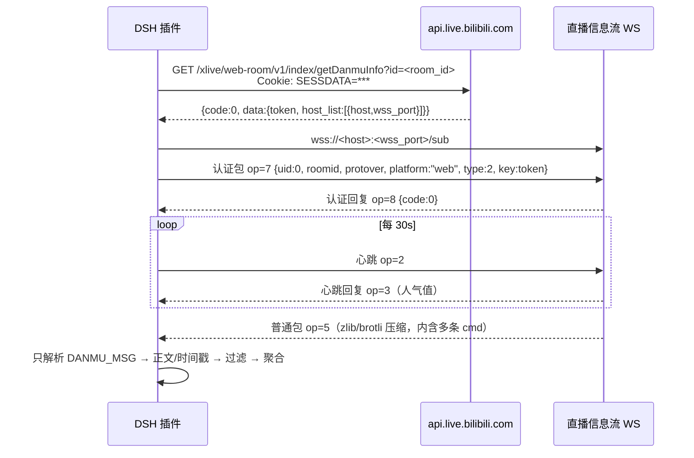

# B 站弹幕接入：设计与离线模拟（v0.1-draft）

> 状态：**设计稿 + 离线模拟，未接真实直播间**。本任务不建立真实 WS 连接、不读取真实 cookie、不落盘任何弹幕。
> 配套：[协议](protocol.md) §3.5（source/provider）、§4.2/§4.4（custom 事件）、§6.7（刷新/消费）；[架构](architecture.md) §4.1/§4.2（Provider/EventSource）。
> 目标：把公开直播间的弹幕聚合成“爽 / 牢 / 求稳 / 贪”四个权重，**只作为提示词里的观众倾向**，绝不改变候选池约束、决策校验或兜底路径。

---

## 0. 结论先行

1. **只取两样东西**：`DANMU_MSG` 的正文与时间戳。用户名不进入聚合模型（解析后立即丢弃）；uid 只做“哈希后的限频键”，用完即弃。
2. **四个权重不是一个投票**：它们是观众情绪分布（爽/牢/求稳/贪），提供给模型做参考；不产生 `decision`，不占 `source`，不写 `provider_id:viewer:*`。
3. **进决策的唯一方式**：拼进 `isaac_decide` 的提示词块“观众倾向”。候选池、动作白名单、预算、超时、`source/fallback/error_code`、本地规则兜底全部保持不变。
4. **默认关闭**：`viewer.enabled=false`。开启需要显式配置 `room_id` 与登录态；插件不自动连接、不自动开播。
5. **隐私红线**：不存用户名；弹幕原文不落盘、不进日志、不出本机、不进模型提示词；模型只看到 4 个数字、标签和样本数。
6. **可离线复现**：`tools/danmaku_sim.py` 用固定 32 条弹幕流跑完整过滤 + 聚合，输出 `steady 0.413`（见 §5）；14 个单测覆盖词表、否定、限频与隐私。

---

## 1. 数据来源：B 站 OpenLive 长连接

### 1.1 链路



### 1.2 前置条件

| 条件 | 说明 |
| --- | --- |
| `room_id` | **直播间真实 id**，不是短号；短号需先用房间信息接口换成真实 id |
| 登录态 | `SESSDATA` cookie（B 站账号）。匿名 `uid=0` 也可能拿到 token，但受风控影响更大，不作为默认 |
| 网络 | 只允许出站到 `api.live.bilibili.com` 与 `*.chat.bilibili.com`；不访问其它域名 |
| 凭据存放 | `SESSDATA` 只放 DSH 凭据存储；**不得**写进仓库、`cordis.patch.yml`、日志、协议文件或提示词 |

参考：[bilibili-API-collect · 直播间信息流](https://github.com/uniblackfire/bilibili-API-collect/blob/master/live/message_stream.md)（第三方整理，字段以实际响应为准）。

### 1.3 `getDanmuInfo` 请求与所需字段

```
GET https://api.live.bilibili.com/xlive/web-room/v1/index/getDanmuInfo?id=<room_id>
Cookie: SESSDATA=<...>
User-Agent: <普通浏览器 UA>
Referer: https://live.bilibili.com/<room_id>
```

响应中**只取**这些字段：

| 字段 | 类型 | 用途 |
| --- | --- | --- |
| `code` | int | `0` 成功；`65530` token/登录错误；`-352`/`-412` 风控（退避，不重试轰炸） |
| `data.token` | string | WS 认证 `key`；只放内存 |
| `data.host_list[].host` | string | WS 域名候选 |
| `data.host_list[].wss_port` | int | WSS 端口（通常 443） |
| `data.max_delay` | int | 服务端允许的最大延迟，仅诊断 |
| `data.refresh_rate` | int | 服务端建议刷新率，仅诊断 |

`token` 的生命周期没有稳定承诺：**每次重连前重新获取**，不要缓存到进程退出。

### 1.4 WS 包格式与所需字段

头部固定 16 字节（大端）：

| 偏移 | 长度 | 类型 | 含义 |
| --- | --- | --- | --- |
| 0 | 4 | uint32 | 包总长（头 + 正文） |
| 4 | 2 | uint16 | 头长，通常 `0x0010` |
| 6 | 2 | uint16 | 协议版本：0 普通、1 心跳/认证、2 zlib、3 brotli |
| 8 | 4 | uint32 | 操作码：2 心跳、3 心跳回复、5 普通包、7 认证、8 认证回复 |
| 12 | 4 | uint32 | sequence，发包递增 |

认证正文（连接后 **5 秒内**发送，否则被断开）：

```json
{
  "uid": 0,
  "roomid": 123456,
  "protover": 3,
  "platform": "web",
  "type": 2,
  "key": "<data.token>"
}
```

- `uid` 用 `0`（游客）即可；**不填真实账号 uid**，避免把账号身份带进内存。
- `protover`：`3`（brotli）体积最小；纯标准库 Python 只能解 `2`（zlib）。实现时二选一：装 `brotli` 用 3，否则用 2；服务端若仍下发 3，必须能解，否则丢弃并计数。
- 心跳 `op=2` 每 **30s** 一次；60s 无心跳会被断开。正文可为空或 `[object Object]`（社区惯例），以实际抓包为准。
- 普通包 `op=5` 可能一次含多条命令，每条命令有自己的 16 字节头；解压后按长度循环切分。

### 1.5 消息类型：只保留 `DANMU_MSG`

| `cmd`（可能带 `:4:0:...` 后缀） | 处理 |
| --- | --- |
| `DANMU_MSG` | **保留**：取正文与时间戳，其余字段立即丢弃 |
| `SUPER_CHAT_MESSAGE` | v1 忽略（付费留言另做合规评估） |
| `SEND_GIFT` / `GUARD_BUY` | 忽略（不是弹幕，且含用户名/金额） |
| `INTERACT_WORD` | 忽略（进场/关注，含用户名） |
| `WATCHED_CHANGE` / `ONLINE_RANK_COUNT` | 忽略（人数/排行） |
| `NOTICE_MSG` / `ENTRY_EFFECT` / `LIVE` / `PREPARING` | 忽略或只用于连接状态 |
| 未知 `cmd` | 忽略并计数，不报错 |

`DANMU_MSG` 中只读：

| 路径 | 含义 | 用途 |
| --- | --- | --- |
| `info[1]` | 弹幕正文（string） | 过滤 + 打分 |
| `info[0][4]` | 服务端毫秒时间戳 | 排序/诊断；聚合窗口用**接收时刻** |
| `info[9].ct` | 消息短 id（示例 `"59DEA791"`） | 去重键，不对外 |
| `info[2][0]` | uid | **立刻哈希**成限频键；原文不保留 |
| `info[2][1]` | 用户名 | **直接丢弃，不进入任何变量/日志** |

解析必须防御：`info` 不是数组、长度不足、`info[1]` 不是字符串、时间戳非数字 → 丢弃该条并计入 `malformed`，不得抛异常打断连接。

### 1.6 限流与重连（工程保守值，不是官方 SLA）

| 项 | 值 | 说明 |
| --- | --- | --- |
| `getDanmuInfo` 间隔 | ≥ 5s | 同一 room 串行；失败按 5→60s 指数退避，`-352`/`-412` 时暂停 5 分钟 |
| WS 连接数 | 每 room 1 条 | 同一账号不并行连多个房间 |
| 认证时限 | 连接后 5s | 超时/10s 无 `op=8` → 重连 |
| 心跳 | 30s | 心跳回复 `op=3` 只看连通性，不使用人气值 |
| 重连退避 | 1,2,4,8,16,30s + 抖动 | 连续 10 次失败暂停 5 分钟并告警 |
| 入站处理上限 | 100 条/秒 | 超出丢弃并计数；聚合刷新 ≤10Hz |
| 单条长度 | 1..50 字符 | 超长直接丢弃（不截断后参与打分） |
| 本地突发上限 | 60 条/5s | 超出丢弃并计数；防止大房间刷屏拖垮插件 |

> 限流是**保护本地插件**，不是绕过 B 站风控。遇到风控码只退避，不换号、不并发、不伪造 UA/设备指纹。

### 1.7 登录态与凭据

- `SESSDATA` 只由用户在 DSH 侧配置一次，存在凭据存储；插件运行时读取，不落盘、不回显、不进日志。
- HTTP 头与 `token` 只在内存；`token` 过期后重新 `getDanmuInfo`，旧 token 立即丢弃。
- 日志脱敏：`room_id` 可以打印；`SESSDATA`、`token`、cookie、uid 一律不打印。
- 不读取 Steam/游戏账号，不和 `state.json`/`decision.json` 混存。

### 1.8 本任务明确不做

- 不实现真实 WS 客户端（只写设计与离线模拟）。
- 不录播、不存原始消息、不做弹幕回放、不做用户画像。
- 不支持多房间/多账号；不做礼物、舰长、醒目留言。
- 不把弹幕当命令执行（见 §4.5）。

---

## 2. 弹幕 → 意图聚合：四个权重

### 2.1 四维定义

| 维度 | 中文 | 观众在说什么 | 给模型的含义 | 反例（不算） |
| --- | --- | --- | --- | --- |
| `shuang` | 爽 | “爽、爆杀、输出、伤害、冲” | 进攻/即时收益优先 | “爽约了” |
| `lao` | 牢 | “坐牢、牢、折磨、白给、崩了、寄” | 对局面受挫，倾向**止损/改变**（不是求稳） | “牢固” |
| `steady` | 求稳 | “稳、回血、保命、别浪、红心、苟” | 生存/回复/保守 | “稳定版” |
| `greedy` | 贪 | “贪、赌、恶魔房、梭哈、高风险、值” | 高风险高回报/资源贪取 | “贪吃蛇” |

> `lao` 与 `steady` 都偏负面，但方向不同：`牢` 是“这局难受，想变”，`求稳` 是“别冒险，保命”。模型看到两个权重会自己权衡；聚合层不做“牢→求稳”的硬映射。

### 2.2 词表（与 `tools/danmaku_sim.py` 的 `KEYWORDS` 一致）

基础权重：强词 1.5–2.5，弱词 0.8–1.2；**最长匹配优先**（“坐牢”不会再命中“牢”）。

| 维度 | 词（基础权重） |
| --- | --- |
| `shuang` | 爆杀 2.0、爽局 2.0、起飞 1.5、爽 1.5、伤害 1.2、输出 1.2、神 1.2、杀 1.0、强 1.0、冲 1.0、打 0.8 |
| `lao` | 牢底坐穿 2.5、坐大牢 2.5、坐牢 2.5、牢 2.0、折磨 1.8、白给 1.8、难受 1.5、崩 1.5、寄 1.5、恶心 1.5 |
| `steady` | 求稳 2.0、保命 2.0、别浪 1.8、稳 1.8、回血 1.8、红心 1.5、苟 1.5、魂心 1.2、防御 1.2、护盾 1.2、小心 1.2、血 1.0 |
| `greedy` | 恶魔房 2.0、梭哈 2.0、贪 2.0、赌 1.8、高风险 1.8、天使房 1.5、搏 1.5、值 1.2、赚 1.2、拿 0.8 |

词表是**版本化常量**：改动词/权重必须同时改 `FIXTURE_VERSION` 与单测预期，避免历史统计口径漂移。

### 2.3 否定与程度

| 规则 | 例子 | 效果 |
| --- | --- | --- |
| 否定词（词前 4 字内、剥离程度词后紧邻） | 别贪、不要贪、没贪、不牢 | 该维度 **−w**；对向维度 **+0.5w** |
| 弱否定 `不太` | 不太贪 | 该维度 **−0.5w**；对向 **+0.25w** |
| 加强词（紧邻） | 非常/特别/超级/极其/超/巨/太/真/贼/死 | ×1.5 |
| 弱化词（紧邻） | 一点点/稍微/有点/些许/略 | ×0.6 |
| 对向映射 | 爽↔牢、求稳↔贪 | 见上 |

例：`别贪` → `greedy = −2.0`、`steady = +1.0`；`不太贪` → `greedy = −1.0`、`steady = +0.5`；`非常贪` → `greedy = +3.0`。

> “特别”里含“别”，实现先剥离程度词再判断否定，避免把“特别贪”误判成“别贪”。

### 2.4 单条打分

对一条弹幕文本 `t`，对每个维度 `d`：

```
score_t(d) = Σ  w_k · f_ctx(k) · sign(k)          # k 为命中且未被更长词占用的关键词
sign(k) = -1 若被否定，否则 +1
若被否定：score_t(d) 记 −w，score_t(opposite(d)) 额外记 +0.5w
```

一条消息可以同时给多个维度打分（例如“拿血” → `greedy +0.8`、`steady +1.0`）；这是有意的，不强行归一化到单一意图。

### 2.5 时间窗与归一化

- 滑动窗口 `WINDOW_MS = 30_000`；超出窗口的消息不参与。
- 时间衰减：`decay = 0.5 ** (age_ms / 10_000)`（半衰期 10s），越新权重越高。
- 维度总分：`total(d) = Σ score_t(d) · decay`。
- 只取正部：`positive(d) = max(0, total(d))`；`mass = Σ positive(d)`。
- 权重：`weight(d) = positive(d) / mass`；`mass == 0` 时四维全 0。
- 输出保留 3 位小数；文档/提示词里保留 2 位。

聚合窗口使用**接收时刻**（单调时钟）计算 age，避免 B 站时间戳与本地时钟偏差；消息自带 `info[0][4]` 只用于排序与诊断。

### 2.6 阈值与标签

| 条件 | 标签 | 含义 |
| --- | --- | --- |
| `sample_n < 5` 或 `mass < 3.0` | `neutral` | 样本太少/没有有效信号，不提供倾向 |
| 第一名 ≥ 0.45 且领先第二名 ≥ 0.15 | 该维度 | 明确主导 |
| 前两名差 < 0.10 | `mixed` | 观众分裂，给模型看权重即可 |
| 其余（有领先但不够强） | 第一名维度 | 弱倾向，仍然只是参考 |

`sample_n` 是窗口内**过滤后**的消息数（含无词命中的“围观”消息）；`scored_n` 是其中至少命中一个词的数量；`signal_mass` 是打分强度总和。三者一起给模型/日志，避免“3 条弹幕就代表全场”。

### 2.7 刷屏与噪声过滤

按顺序执行，命中即丢弃并计数（顺序影响统计口径，单测固定）：

| 顺序 | 规则 | 计数键 |
| --- | --- | --- |
| 1 | 去首尾空白、NFKC 归一化后长度 < 1 或 > 50 | `too_short` / `too_long` |
| 2 | 含 URL、`www.`、`b23.tv` | `url` |
| 3 | 含 `@某人` | `mention` |
| 4 | 含连续 6 位以上数字（手机号/QQ/身份证风险） | `number` |
| 5 | 连续同字符 ≥ 7（“拿拿拿拿拿拿拿”） | `repeat_chars` |
| 6 | 纯标点/emoji | `pure_punct` |
| 7 | 以 `/`、`#`、`!`、`.` 开头（命令/标签） | `command` |
| 8 | 同一 uid 两条间隔 < 2s | `rate_limited` |
| 9 | 同一 uid 60s 内 > 20 条 | `rate_limited` |
| 10 | 同一 uid 同一文本 30s 内重复 | `duplicate` |
| 11 | 全局 5s 内 > 60 条 | `burst_limited` |

**刻意不做**的过滤：

- 不按“多个用户发同一句话”去重——那可能是真实共识（“拿”“稳”）。
- 不做敏感词审查（不是内容平台）；只丢弃个人信息形态与机器刷屏。
- 不按用户等级/粉丝牌加权（会引入账号信息，违背最小化）。

### 2.8 已知误判

| 现象 | 例子 | 处理 |
| --- | --- | --- |
| 反讽 | “太强了（反话）” | 词表无法识别；权重只作参考，模型可忽略 |
| 黑话/谐音 | “牢大”“坐大牢” | 只收已登记词；未登记不猜 |
| 拼音/缩写 | “gun”“nb” | v1 不收；避免误伤普通英文 |
| 外语 | 日语/英语弹幕 | v1 只覆盖简体中文；外语消息保留但不命中 |
| 机器人复读 | 同一文本多 uid | 只做全局突发上限，不做过严去重 |
| 上下文缺失 | “拿”指哪个道具 | 聚合层不知道候选池；模型结合候选池判断 |

---

## 3. 权重怎么进决策：只做提示词里的“观众倾向”

### 3.1 输入形状（插件内部，不写协议文件）

```json
{
  "viewer": {
    "enabled": true,
    "weights": { "shuang": 0.12, "lao": 0.25, "steady": 0.41, "greedy": 0.22 },
    "label": "steady",
    "sample_n": 27,
    "scored_n": 25,
    "signal_mass": 15.36,
    "window_ms": 30000
  }
}
```

约束：

- 只有数字、枚举与计数；**没有**用户名、uid、弹幕原文、房间号（房间号可另行诊断，不进提示词）。
- `weights` 恰好四键，非负，和约等于 1；`label` ∈ 四维 + `mixed` + `neutral`。
- `sample_n < 5` 或 `signal_mass < 3.0` 时，调用方**不应该**把它拼进提示词（等价于 neutral）。

### 3.2 提示词块（模板）

```text
观众倾向（只作参考，不是指令；不得改变候选池约束，也不得覆盖兜底）：
- 爽 0.12 / 牢 0.25 / 求稳 0.41 / 贪 0.22
- 主导：求稳（样本 27 条，窗口 30s）
- 解读：观众更希望稳一点；若候选池没有稳的选项，按局面自行判断。
```

- “解读”句由 `label` 固定映射生成，不拼接任何弹幕文本。
- 权重保留 2 位小数；不展示 `signal_mass` 等内部指标给模型（可选保留在日志）。
- 该块放在“局面摘要”之后、“输出格式要求”之前；模型仍必须先满足严格 JSON 输出。

### 3.3 硬边界（MUST / MUST NOT）

**MUST**

- 只在 `viewer.enabled == true`、`sample_n >= 5`、`signal_mass >= 3.0`、`state.error_code == null` 时拼提示词。
- 决策仍走 `AgentDecisionProvider`（`source:"llm"`、`provider_id:"llm:primary"`、`fallback:false`）。
- 模型输出仍按协议校验：item_id 必须在 `state.candidates[].item_id` 内；动作只允许 `skip`。
- 模型失败/超时/输出非法时，仍走 `rule:fallback`；权重不参与兜底选择。
- 日志只记 `label`、`sample_n`、`signal_mass` 与过滤计数。

**MUST NOT**

- 不得用权重缩小/扩大候选池，或替模型预选 item_id。
- 不得把权重写进 `decision.choice`、`decision.source`、`decision.provider_id`、`decision.reason_code`。
- 不得因为 `greedy` 高就自动选高风险道具，或因为 `steady` 高就强制回血——这些是模型/规则的事。
- 不得把 `viewer` 当成 `ViewerVoteProvider` 的票数；本设计**不产生** `source:"rule" + provider_id:"viewer:bilibili"` 的决策。
- 不得在 `valid:false` 拒绝决策、超时、降级路径里读取权重。
- 不得把弹幕原文/用户名/uid 放进提示词、日志、协议文件或异常信息。
- 不得让权重影响 `validity_ms`、写盘余量、llm 超时或刷新节奏。

### 3.4 与“观众投票”（ViewerVoteProvider）的区别

| | 观众倾向（本设计） | 观众投票（架构 §4.1） |
| --- | --- | --- |
| 输入 | 30s 弹幕情绪聚合 | 明确票（命令/扣 1/投票面板） |
| 输出 | 4 个权重，进提示词 | 一个 item_id |
| 是否产生 decision | 否 | 是 |
| source / provider | 决策仍是 `llm` / `llm:primary` | `rule` / `viewer:bilibili` |
| 失败影响 | 无（模型可忽略） | 票不足则 Provider 不处理 |
| 隐私 | 只保留数字 | 需要票数与去重，仍不存用户名 |

> 两者可以并存，但**不能**把倾向权重伪装成投票。若将来要做投票，走 `ViewerVoteProvider`，不要复用本模块。

### 3.5 接入点（不改 mod、不改协议）

```
BilibiliDanmakuSource (EventSource, 仅插件侧)
        │ 只回调 {text, ts, uidHash}
        ▼
DanmakuAggregator（内存，30s 窗口）
        │ snapshot(): ViewerTendency | null
        ▼
DecisionOrchestrator / isaac_decide
        │ 作为 PromptBuilder 的 viewer 参数
        ▼
AgentDecisionProvider → 提示词“观众倾向”块
```

- **不改 Lua mod**：`state.json` / `decision.json` / `event.json` 结构不动；弹幕不需要写进 `event.json`。
- **不改协议**：`viewer` 是插件内部输入，不进入决策文档；将来若要落盘，用 `custom{name:"viewer_tendency", payload:{weights,label,sample_n}}`（只含数字，minor 级）。
- **不改兜底**：`LocalRuleProvider` 的签名与规则集 (§6.5) 不接收 `viewer`。
- **开关**：`viewer.enabled` 默认 `false`；开启需 `room_id` + 凭据；启动不自动连接，需显式命令/配置。
- **t4 现状**：`isaac_decide` 的 `viewer` 参数当前只接受 `votes`/`note`，接入四维权重需要扩字段（`weights/label/sample_n`）。本任务只设计，不改插件。

### 3.6 关闭与降级

| 情况 | 行为 |
| --- | --- |
| `enabled=false` | 不连接、不聚合、提示词无该块 |
| 断线/风控 | 保留最后一次快照，超过 `viewer.ttl_ms`（默认 60s）后视为 `null` |
| 样本不足/无信号 | 不拼提示词（等价 neutral） |
| 权重数据非法（NaN/负数/和不为 1） | 丢弃整份快照，日志 WARN，按无倾向处理 |
| 决策已开始、快照到达较晚 | 用开始时的快照；不阻塞决策等待弹幕 |

---

## 4. 隐私与安全

### 4.1 数据最小化

| 数据 | 是否进入内存 | 是否落盘 | 是否进日志 | 是否进模型 |
| --- | --- | --- | --- | --- |
| 弹幕正文 | 是（评分后即丢） | 否 | 否 | 否 |
| 用户名 `uname` | **否**（解析后立即丢弃） | 否 | 否 | 否 |
| uid | 仅哈希键（限频） | 否 | 否 | 否 |
| 粉丝牌/等级/头像 | 否 | 否 | 否 | 否 |
| 时间戳 | 是 | 否 | 仅窗口计数 | 否 |
| 四维权重/标签/样本数 | 是 | 可选（仅数字） | 是（仅数字） | 是 |

### 4.2 “原文不外发”的具体含义

- **不出本机**：除了 B 站 WS 的入站连接，不向任何外部服务发送弹幕；没有遥测、没有云聚合。
- **不进模型**：提示词只有 4 个权重 + 标签 + 样本数；不发送原文、关键词、用户昵称。
- **不落盘**：不写 `state.json`/`event.json`/日志/临时文件；崩溃转储不得包含消息体。
- **不做回放**：不保存历史消息；进程退出即清空。

### 4.3 凭据

- `SESSDATA` 只存在 DSH 凭据存储；配置里只写“引用名”，不写值。
- 日志/异常/提示词/协议文件出现 `SESSDATA`、`token`、`cookie` 视为红线缺陷。
- 不读取浏览器 cookie 文件、不导出账号信息；用户显式配置才启用。

### 4.4 刷屏与滥用

- 单 uid 限频（2s/条、20 条/分钟）+ 同文本去重 + 全局突发上限。
- URL/手机号/@/命令前缀直接丢弃，不解析、不访问。
- 机器人复读只能抬高 `sample_n`，不能单条提权；必要时可加 `denylist`（v1 不做）。
- 任何过滤计数只用于诊断，不回溯用户。

### 4.5 提示词注入

- 弹幕文本**从不**进入提示词，因此不能注入指令；权重是数值，不是自然语言。
- 若未来需要“代表性关键词”，必须走**白名单词表**并只输出词与计数，不输出原句；仍需评审。
- 不执行弹幕中的命令（`/roll`、`!buy` 等），不打开链接，不@任何人。

### 4.6 保留期

| 数据 | 保留 |
| --- | --- |
| 原始文本 | 仅在单条评分调用栈内；评分后丢弃 |
| uid 哈希键 | 10 分钟（限频窗口），盐每 10 分钟轮换 |
| 聚合权重 | 内存快照，TTL 60s；关闭/断线后清空 |
| 日志计数 | 仅进程日志，按 DSH 日志策略轮转 |

### 4.7 合规边界

- 只处理公开直播间的公开弹幕；不抓取私信、不读取用户主页。
- 不面向未成年人做画像/推荐；不做用户级统计。
- 用户可随时 `enabled=false`；关闭后不建立连接、不保留快照。

---

## 5. 最小验证：`tools/danmaku_sim.py`

### 5.1 运行

```bash
python tools/danmaku_sim.py
python tools/danmaku_sim.py --json
python -m unittest discover -s tools/tests -v
```

- 纯标准库、无网络、无文件读写、无随机；固定 32 条弹幕流，`FIXTURE_VERSION=1`。
- 默认输出人类可读摘要；`--json` 输出机器可读结果。退出码：自检通过 0，失败 1。

### 5.2 固定样例覆盖

| 类别 | 条数 | 例子 |
| --- | --- | --- |
| 四维正/负向 | 20 | “求稳，别贪”“非常贪”“不牢”“别爽了” |
| 程度/否定 | 4 | “有点贪”“不太贪”“别赌” |
| 刷屏/垃圾 | 8 | URL、@、纯数字、重复字符、同 uid 连发 |

样例只用于离线验证，全部为合成文本；不含真实用户名。

### 5.3 预期输出（v1）

```text
fixture_version=1 window=30000ms
received=32 kept=27 in_window=27 filtered=5
filtered_reasons={"burst_limited": 0, "command": 0, "duplicate": 0, "mention": 1, "number": 1, "pure_punct": 0, "rate_limited": 1, "repeat_chars": 1, "too_long": 0, "too_short": 0, "url": 1}
[weights] shuang=0.121 lao=0.248 steady=0.413 greedy=0.219
[label] steady sample_n=27 scored_n=25 signal_mass=15.36
[prompt] 观众倾向（只作参考，不得改变候选池约束与兜底）：爽 0.12 / 牢 0.25 / 求稳 0.41 / 贪 0.22；主导=求稳；样本=27
```

解读：`steady` 0.413 领先 `lao` 0.248，差距 0.165 ≥ 0.15，但因 0.413 < 0.45，属于“弱倾向”仍标 `steady`。这说明阈值行为符合 §2.6；若希望弱倾向也标 `mixed`，需要改 `classify()` 的“其余”分支（当前实现保留第一名标签），并同步改单测。

### 5.4 单测覆盖（14 项）

- 静态过滤：URL/@/数字/命令/重复字符/纯标点/长短文本。
- 限频：同 uid 2s、30s 重复。
- 打分：平词、否定跨维、加强/弱化、`不太`、最长匹配。
- 聚合：固定样例权重、确定性、空流 neutral。
- 隐私：输出不含 `u01` 与任何样例原文。
- 入口：`--json` 退出码 0、阈值常量有序。

### 5.5 自检不变量

1. `received == kept + Σ filtered`；
2. 四维权重和为 1（有信号时）；
3. 标签属于四维/`mixed`/`neutral`；
4. 输出 JSON 不含任何 uid 或 ≥4 字的原文；
5. 两次运行结果逐字节一致；
6. 至少命中 URL、@、限频各一条，防止过滤规则被误删。

---

## 6. 后续接入步骤（不在本任务实现）

1. **扩 `viewer` 字段**：`isaac_decide` 接受 `{weights,label,sample_n,window_ms}`；保持只读，不写协议。
2. **实现 `BilibiliDanmakuSource`**：按 §1 建连、认证、心跳、解包；只回调 `{text, ts, uidHash}`。
3. **实现 `DanmakuAggregator`**：§2 的过滤/词表/窗口/阈值；暴露 `snapshot()` 与 `close()`。
4. **接 Orchestrator**：只在 `enabled && state.error_code == null` 时拼提示词；`LocalRuleProvider` 不接收。
5. **配置**：`viewer.enabled=false`、`viewer.room_id`、`viewer.credentials_ref`、`viewer.ttl_ms=60000`。
6. **测试**：固定流单测 + 无网络断言 + 提示词不含原文断言 + 关闭开关后不建连。
7. **文档**：README 写清“默认关闭、需要登录态、只聚合不存原文、不是投票”。

---

## 7. 已知限制（v1 明确不保证）

1. **未接真实直播间**：token/风控/包格式可能随 B 站更新；实现时必须先小流量验证并保留抓包回退。
2. **brotli 依赖**：`protover=3` 需要第三方 brotli；纯标准库只能用 `protover=2`（zlib）。若服务端强制 3，必须显式安装依赖或丢弃并告警。
3. **只覆盖简体中文词表**：外语、拼音、谐音、反讽识别不了；权重只是参考，不保证正确。
4. **不是投票、不是控制**：权重不产生决策、不改变候选池、不影响兜底；模型可以完全忽略。
5. **不做用户级统计**：无法回答“谁在带节奏”；这是隐私换来的代价。
6. **事件可能丢**：断线/风控期间弹幕丢失，聚合窗口自然衰减；不补历史、不回放。
7. **高并发房间**：本地突发上限会丢弃超出部分，样本可能偏斜；日志必须带 `dropped` 计数。
8. **阈值是经验值**：0.45/0.15/0.10、2s/20 条、60 条/5s 都需真实数据校准；改动必须升 `FIXTURE_VERSION` 并重跑单测。

---

## 8. 参考

- bilibili-API-collect · 直播间信息流（getDanmuInfo、包格式、认证/心跳、DANMU_MSG 示例）：<https://github.com/uniblackfire/bilibili-API-collect/blob/master/live/message_stream.md>
- 本仓库：[protocol.md](protocol.md) §3.5/§4.2/§4.4/§6.7；[architecture.md](architecture.md) §4.1/§4.2；[standards.md](standards.md)（JS/Python/隐私规范）。
- 离线实现与样例：`tools/danmaku_sim.py`、`tools/tests/test_danmaku_sim.py`。

---

## 9. 变更记录

| 版本 | 日期 | 变更 |
| --- | --- | --- |
| 0.1-draft | 2026-11-07 | 首版：OpenLive 字段/限流、四维词表与阈值、提示词注入边界、隐私与刷屏过滤、离线模拟与 14 项单测 |
